# 🐾 PAWVERSE DASH

### Seven cute heroes. Seven magical worlds. One endless adventure.

**Colourful Three.js 3D endless runner · Solo adventure · Two-player split-screen race**

[Play locally](#-quick-start) · [Animal worlds](#-meet-the-seven-heroes) · [Controls](#-controls) · [Two-player race](#-two-player-duo-race) · [Contribute](#-contributing)

---

## ✨ About the game

**Pawverse Dash** (formerly Polar Dash) is a cheerful 3D runner where each animal explores a world of its own. Run down a three-lane path, avoid obstacles, jump, slide, grab coins and energy, and unlock more friends. The active character controls the **entire world**: the sky, colour palette, painted roadway, scenery, landmarks and obstacle selection.

The game runs in the browser with **Three.js + Vite**. It uses lightweight procedural 3D art, runtime-generated road textures and sky shaders. The same codebase includes a **local two-player race** with independently themed views.

> **Visual fidelity:** The concept illustration is a design target, **not** an actual in-game screenshot. Current models and props are stylized procedural meshes; achieving film-quality fur, perfectly sculpted animals and detailed environments requires additional textured/rigged assets. The header SVG is illustrative artwork, not a live render.

## 🌎 Meet the seven heroes

| Hero | World | Road and main landmarks | Solo unlock |
|:---|:---|:---|---:|
| 🐰 **Bella Bunny** | Bunny Meadow 🌼 | Soft dirt, daisies, fences, leafy trees and a burrow | Free |
| 🦄 **Ula Unicorn** | Unicorn Skyland 🌈 | Glowing pastel bridge, rainbow arch, floating islands and crystals | 150 coins |
| 🐴 **Hugo Horse** | Horse Prairie 🌾 | Golden earth, windmills, hay and rustic fences | 250 coins |
| 🐱 **Coco Cat** | Cat Town 🏘️ | Warm cobblestones, pastel houses and a clock tower | 350 coins |
| 🐶 **Dodo Dog** | Puppy Park 🌳 | Stepping-stone path, pond, flowers and gazebo | 450 coins |
| 🐧 **Pip Penguin** | Penguin Glacier ❄️ | Blue ice road, snow trees, crystals and glacial arch | Free |
| 🐮 **Mimi Cow** | Mimi Farm 🚜 | Countryside trail, crops, red barn, silo and fences | 700 coins |

**Change the character → change the world.** World transitions happen when choosing a hero in the Character Shop. The two-player mode creates each runner's biome separately.

## 🎮 Gameplay and features

| Feature | How it works |
|:---|:---|
| **Solo endless run** | Accelerate from 18 up to 58 world units/second, with increasingly challenging obstacle rows |
| **Movement** | Three lanes, jumping, sliding and smooth lane transitions |
| **Obstacles** | World-specific rocks, spikes, raised log gates, and an Arctic lion |
| **Collision reliability** | Swept collision detection checks the full travelled distance, side movement and jump height **between frames**, preventing common high-speed tunnelling |
| **Log gates** | Slide underneath the raised wooden beam; jumping and dodging remain options according to clearance |
| **Energy and rewards** | Collect coins; energy pickups replenish stamina |
| **Solo power-ups** | Shield blocks a hit; magnet helps collect coins |
| **Shop** | Spend earned coins to unlock heroes; selected hero and world are remembered |
| **Visuals** | Animated animal limbs, custom third-person cameras, parallax nature, bright sky shaders, clouds, seven textured track styles and distinct 3D landmarks |
| **Progress** | Best distance, coin balance and unlocks saved in browser local storage |
| **Sound** | Optional synthesized effects with an on/off toggle |

### 🛡️ Collision fix

Obstacles are no longer checked solely at the character's end-of-frame position. Both modes now use `src/collisionMath.js` to find overlapping **time intervals** along the runner's forward path, lane transition and jump.

- Fast animals cannot skip a rock or spike between two frames.
- Moving across lanes checks the path taken, not just the lane where the animal ends the frame.
- High jumps can clear obstacles only when the character is above the obstacle at the time of crossing.
- Sliding can clear overhead wooden log gates, not rocks and spikes.
- After a shielded hit or during brief post-impact immunity, a contacted obstacle disappears rather than visibly passing through the animal.

Automated tests cover these cases in `tests/collisionMath.test.js`. Runtime appearance and game feel still need manual desktop/mobile playtesting.

## 🏁 Two-player Duo Race

Two friends race on **one screen**. Desktop uses side-by-side views; portrait mobile stacks the views. Each player chooses from all seven animals and has their own camera, themed scenery, distance, energy, coins, and obstacle-contact feedback. The obstacle-lane pattern is deterministic for fairness.

**Objective:** Be the first to reach **1,000 metres**. Obstacles slow and drain energy; energy pickups help recovery. The mode is local multiplayer, **not** online networking.

| Action | Player 1 | Player 2 |
|:---|:---|:---|
| Left / right | `A` / `D` | `J` / `L` |
| Jump | `W` or Space | `I` |
| Slide | `S` | `K` |
| Mobile | Swipe inside first viewport | Swipe inside second viewport |
| Pause | `P`, Escape or on-screen button | Shared pause |

Race entry point: **http://localhost:5173/race.html** when the dev server is running.

## 🚀 Quick start

**Requirements:** Node.js, npm, a modern browser with WebGL. Use **Windows CMD**, VS Code terminal or Antigravity terminal.

### First installation

~~~cmd
git clone https://github.com/mothinisuresh14072002/penguin-game.git
cd penguin-game
npm install
npm run dev
~~~

Open **http://localhost:5173/** or the Vite address displayed in your terminal.

### Already cloned? Update your game

Run inside your local `penguin-game` folder:

~~~cmd
git pull origin main
npm install
npm run dev
~~~

### 🕹️ Controls

| Action | Keyboard | Mobile |
|:---|:---|:---|
| Move lanes | `A` / `D` or `←` / `→` | Swipe left/right |
| Jump | `W`, `↑` or Space | Swipe up/tap |
| Slide | `S` or `↓` | Swipe down |
| Pause | `P` or pause button | Pause button |
| Sound | Sound button | Sound button |

### Build and test

~~~cmd
npm run build
npm run preview
~~~

Run the complete unit test suite:

~~~cmd
node --test tests/*.test.js
~~~

`dist/` contains both solo and race HTML entry points. GitHub Actions runs syntax checks, unit tests and a Vite production build after pushes to `main` and on pull requests.

## 🗂️ Project structure

~~~text
penguin-game/
├── index.html                    Solo runner entry point
├── race.html                     Two-player race
├── src/
│   ├── main.js                   Solo gameplay, world selection, rendering
│   ├── race.js                   Split-screen multiplayer logic
│   ├── collisionMath.js          Swept hazard contact detection
│   ├── raceMath.js               Race physics and fair obstacle generation
│   ├── animalArt.js              Seven procedural animated chibi animals
│   ├── modelAssets.js            Optional GLB character loading and fallback
│   ├── characterPreviews.js      3D portraits in the character shop
│   ├── roadArt.js                Seven repeated illustrated road textures
│   ├── landmarkArt.js            Biome-specific 3D landmark collections
│   ├── worldArt.js               Reusable roadside scenery geometry
│   ├── visual3d.js               Sky dome and distant horizon
│   ├── style.css                 Solo game interface
│   └── race.css                  Split-screen interface
├── tests/                        Collision, race, worlds and art tests
├── public/models/               Optional downloaded GLB assets
├── assets/readme-banner.svg      Illustrative animated README header
├── capacitor.config.json         Android wrapper configuration
├── docs/PLAY_STORE_RELEASE.md    Android release checklist
├── PRIVACY.md                    Prototype privacy notes
└── .github/workflows/build.yml   CI workflow
~~~

## 🐰 Bringing in a custom bunny GLB

The optional `public/models/bunny.glb` file can override Bella Bunny **only if it has usable painted materials or texture information**. Unpainted white Meshy exports are deliberately skipped: the colourful procedural bunny remains visible instead.

To add your own properly textured model, put `bunny.glb` in `public/models/`, then run:

~~~cmd
git add public/models/bunny.glb
git commit -m "Add textured Bella Bunny model"
git push origin main
~~~

The imported GLB is fitted to the game height and uses included animation clips when present; unrigged models only receive a basic bob animation. **This model binary is not currently committed to the repository.** See [GLB installation notes](public/models/README.md).

## 📱 Android prototype

The project includes **Capacitor** support for packaging the web game in Android Studio.

~~~cmd
npm install
npm run build
npm run android:add
npm run android:sync
npm run android:open
~~~

Run `npm run android:add` only if no Android project already exists. For subsequent changes, just use `npm run android:sync`.

**Release status:** The game has **not** been signed, confirmed on physical Android devices, submitted or published to Google Play. See [release checklist](docs/PLAY_STORE_RELEASE.md) and [privacy policy](PRIVACY.md).

## 🛣️ Roadmap

- [x] Seven selectable characters with matching 3D environments
- [x] Distinct road textures, landscape colours, props and landmarks
- [x] Solo gameplay with coins, energy, shields and magnets
- [x] Local, fair, same-screen two-player race
- [x] Reliable high-speed swept collision logic and automated regression tests
- [x] Custom sky shader, animated weather and world scenery
- [x] CI checks for JavaScript, world art, race physics and builds
- [ ] Browser-based gameplay automation and physical-device collision testing
- [ ] Fully textured and rigged cinematic-quality character assets
- [ ] Mobile FPS tuning, accessibility review and quality presets
- [ ] Original real gameplay screenshots, trailer and complete onboarding
- [ ] Signed and tested Android release

## 🤝 Contributing and feedback

Bug reports and contributions are welcome through [GitHub Issues](https://github.com/mothinisuresh14072002/penguin-game/issues). Please include the affected character/world, mode (solo/race), browser or device, and reproduction steps.

**Created and maintained by [Mothini S.](https://github.com/mothinisuresh14072002).**

**🐾 PAWVERSE DASH — every animal has a world.**

Built with Three.js · Vite · JavaScript · Capacitor

